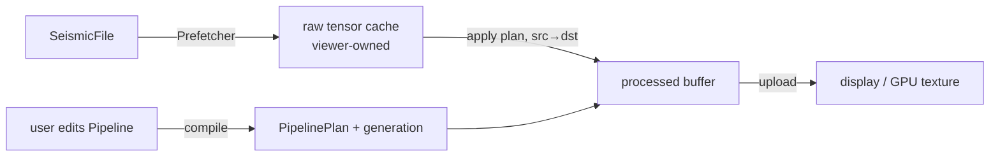

# Integrating parseSEG, processSEG and the viewer

Status: **draft**, written before the viewer exists. It fixes who owns what, the data that
crosses each boundary, and the changes parseSEG needs. Update it whenever an API it
describes changes.

## The three parts

| Part | Owns | Never does |
|---|---|---|
| **parseSEG** | Files: open, index, keys, headers, sample decode into tensors, prefetch, writers, journaled header edits, survey geometry joins (SPS, P1) | Signal processing; knows nothing of processSEG |
| **processSEG** | Numerics on traces: FFT and spectra, filters, gain, mutes, statics, velocities and moveout, NMO, stacking, geometry QC, first breaks | UI; owning the viewer's open files or caches |
| **viewer** | Sessions, open files, caches of decoded data, threads that keep the UI responsive, drawing (CPU or GPU), user parameters | Decoding formats or doing DSP itself |

Dependencies point one way: `viewer → processSEG → parseSEG`, and `viewer → parseSEG`
directly. processSEG imports parseSEG for its tensor type (Arraymancer `Tensor[T]`, which
parseSEG re-exports) and, in its adapter and batch modules only, for `SeismicFile`.

## Who reads the file?

**The viewer does.** It opens the `SeismicFile` with parseSEG, runs the `Prefetcher`, and
keeps the decoded *raw* tensors. It hands processSEG a tensor plus a small metadata record
(`ChunkMeta`), and processSEG processes it in place or into a second buffer.

The processSEG core never opens a file, so it is testable on synthetic arrays and usable
on data from anywhere. Two thin layers sit on top of it:

- **Metadata adapters** (`processSEG/adapters`): `chunkMetaInto(f, traces, var meta)`
  fills a `ChunkMeta` from a `SeismicFile` and a trace range or list. It reuses `meta`'s
  storage, like parseSEG's `traceKeysInto` and `traceFieldColumnInto`, so a chunk costs no
  allocation. Header reads are thread-safe in parseSEG, so it may run on any thread.
- **Batch drivers** (`processSEG/batch`): jobs that must read many traces in a particular
  order, such as a brute stack or a first-break pass over a whole file. They take a
  `SeismicFile`, read through parseSEG's prefetcher, report progress through a
  `Progress`-style hook that can cancel, and return in-memory results.

## Data contract

- **Samples:** `Tensor[float32]` (or `float64`) shaped `[traces, samples]`, row-major and
  C-contiguous, exactly what `readTraces`, `readTracesInto` and `PrefetchChunk.samples`
  return. The kernels underneath take `var openArray[T]` rows, so a caller can also pass
  any contiguous buffer.
- **One sample interval per call.** A chunk passed to a plan has a single `dt`. SEG-D
  records can mix intervals across channel sets, so the viewer (or the adapter) splits
  chunks by channel set. Auxiliary traces are excluded with parseSEG's `isSeismic`.
- **`ChunkMeta`.** Unknown values are NaN, as in parseSEG's `TraceKeys`.
  - Per chunk:
    - `dtMs`;
    - `firstSample`: the window origin, 0 unless the rows were decoded with a sample
      window (`readTracesInto(..., samples)` or the prefetcher's `firstSample`).
  - Per row:
    - `t0Ms`: the time of the trace's sample 0;
    - `liveSamples`: the trace's real sample count. Rows are zero-padded past a shorter
      trace's end, and filters, AGC and padding stop at that count;
    - `live`: false for decode failures (parseSEG's zero rows), for traces marked dead by
      their trace-identification code, and for traces the caller excludes;
    - `offset`, signed as in the file. Formulas use |x|; split-spread QC uses the sign;
    - `srcX`, `srcY`, `srcZ`, `rcvX`, `rcvY`, `rcvZ`, `cmpX`, `cmpY`;
    - `bin`: a CDP number, or inline and crossline.
- **Time axis:** sample `j` of row `r` is at `t0Ms[r] + (firstSample + j) · dtMs`.
- **Units:** time in ms, frequency in Hz, gain in dB, and velocity in distance units per
  second, with distance in the file's coordinate units (`summary.coordinateUnits`).
  processSEG never converts feet and metres silently.
- **Errors:** as in parseSEG. A bad argument (an empty band, a negative window) raises
  `ValueError` when the plan is built, not per chunk. Applying a valid plan does not raise.
  NaN or Inf in the input stays local to its trace and does not poison its neighbours.

### Where the geometry comes from

- **SEG-Y:** offsets and coordinates come from the trace headers. Inline and crossline
  often sit in non-standard bytes that the file's Layout stanza describes, and
  `TraceKeys` has no inline/crossline fields. The adapter reads them with
  `traceFieldColumn` on the layout field names.
- **SEG-D Rev 1/2:** the headers carry receiver and source line, point and index, but no
  coordinates, so the offset is NaN. The viewer joins SPS or P1 with
  `SurveyGeometry` and `applySurvey` on a file opened with `keys = true`; the adapter then
  takes the joined keys. Without a join, moveout ticks, NMO and stacking have no offsets.
- **SEG-D Rev 3 and SEG-2:** coordinates when the file has them; offsets are derived from
  them.

## Plans and buffers: the interactive loop

A processing flow is a `Pipeline`: an ordered list of operations, held as plain data. The
viewer edits it when the user moves a slider. Compiling it for a `dt` and a trace length
gives a `PipelinePlan`, with filter responses, FFT plans and gain curves precomputed. A
plan is immutable after compilation and carries a `generation` id. Each thread brings its
own `Workspace`: grow-only scratch that keeps `apply` from allocating.

- **In place where possible.** `apply(plan, var x, meta, ws)` works in place. The viewer,
  though, must keep the raw data so that it can reprocess when a parameter changes, so it
  uses `apply(plan, src, var dst, meta, ws)`. That form costs one copy fused into the first
  operation, never a separate pass. A batch job with no raw cache works in place.
- **Recompiling is cheap** (microseconds to a few ms), so the viewer can recompile on every
  slider event, or on a zoom that changes the trace length. `ws.reserve(plan)` is a no-op
  when the workspace is already big enough. The viewer tags each processed buffer with the
  plan's generation and reprocesses any buffer whose generation is stale.
- **Threads.** Kernels are single-threaded and reentrant, with no globals.
  - Arraymancer tensors and Nim seqs are ref-counted, and the count is not atomic, so no
    tensor or plan value may be copied into another thread.
  - The threaded entry points take `ptr PipelinePlan` and raw row pointers, as parseSEG's
    prefetcher does internally.
  - The plan must outlive every thread using it.
  - Parallelism comes from the caller's threads, from processSEG's opt-in `parallelApply`
    (a worker count, ptr-based), or from parseSEG change P2.

## Sample windows and edge effects

Filters and AGC need context beyond the samples on screen. A zoomed view that decodes
only samples `a..b` would show edge artefacts at both ends of the window.

- `requiredMargin(plan)` gives the extra samples to decode on each side. It comes from
  the impulse-response length of the filters and from half the AGC window.
- The viewer decodes `max(0, a − m) .. b + m` and sets `firstSample` in the `ChunkMeta`
  to match. After processing, it draws `a..b`.

At the true ends of a trace, processSEG does the edge handling itself:

1. remove the mean or a linear trend;
2. pad by odd reflection, which keeps the value and the slope continuous, for as long as
   the filter's impulse response;
3. taper the pad only;
4. choose an FFT size at which the response does not wrap.

So the first samples of a trace do not swing after a low-cut such as 1 Hz.

## Display gain: CPU or GPU

Viewers usually offer **fixed**, **normalized** and **AGC** display gain.

- **Fixed and normalized** gain are a scale factor per trace or per panel. processSEG
  computes the statistics (`traceStats`: per-trace RMS and max, and percentile clip values
  for a panel), and the viewer can apply the factor as a shader uniform, with no CPU pass
  over the samples.
- **AGC, time-variant dB curves and filters** change sample values in a way that depends
  on time, so they run on the CPU, in the plan.

Both paths give the same picture: the CPU gain ops exist too, for exports and tests.

## Overlays: moveout ticks for geometry checks

The viewer passes each trace's offset (from `ChunkMeta` or `traceKeys`) and the user's
velocity parameters. processSEG returns one time per trace for each curve:

- linear moveout, `t = t0 + |x| / v`, for first-break and refraction checks;
- hyperbolic moveout, `t = sqrt(t0² + x² / v²)`, for reflections;
- either kind from a velocity function or field instead of a constant velocity (later).

The constant-velocity form ships early, with the pipeline. The viewer draws these ticks.
If the ticks drift from the first breaks across a spread, the geometry is suspect.
processSEG's QC module can also score this fit automatically, with an offset-binned or
two-segment fit, because land refractor velocities vary.

## Batch results: brute stack

`bruteStack(f, velocity, binning, flow, opts, progress)` reads the file through parseSEG.
On each trace it runs the pre-stack flow (offset-variant mute, elevation statics, filter,
gain) and NMO with a stretch mute. It accumulates the result into CMP bins in any order,
because stacking is linear and needs no sort, keeping a live count per sample.

It returns a `StackResult`: a `[bins, samples]` tensor, the fold, and the bin geometry.
It uses about bins × samples × 8 bytes, as float32 for the sum plus the live count. The
viewer shows the result as an in-memory dataset. Writing it to a file needs parseSEG
change P3.

## Proposed parseSEG changes

| # | Change | Why |
|---|---|---|
| P1 | A public `startTimeMs(f, trace)` (and a column form): the time of sample 0, across standards. SEG-Y: delay recording time × the time scalar. SEG-D: the channel set start time (`segd startTimeMs`, already public on the reader). SEG-2: DELAY. | Every time-dependent operation, and every time axis, needs it. Today the SEG-Y/SEG-2 resolution is private (`segyTimeMs` in `convert/toseg2`). The adapter reproduces it until then. |
| P2 | An optional per-chunk `transform` on `newPrefetcher`, run on the worker thread right after decoding. It gets: the worker index (so each worker owns a `Workspace`), the chunk's rows as a raw pointer with its shape, the trace indices of the rows (in selection mode, `first` is a list position), and the failed rows. It is `{.gcsafe, raises: [].}` and captures only raw pointers to state that outlives the prefetcher. | Processing then runs on the prefetch workers while the chunk is still in cache, which suits batch jobs. It is optional: batch code can also process right after `next` on the consumer thread, and the viewer, which keeps raw data, processes on its own threads either way. |
| P3 | A writer path for derived traces: `writeTrace` with header overrides, such as a template trace's headers with `cdp`, `fold` and `offset` changed. | It lets a stack, or other derived traces that have no source trace, be written as SEG-Y. |
| P4 | A helper that splits a range or list into runs of one channel set and one sample interval. | Optional: `channelSets` and `sampleIntervalUs(f, trace)` are public, so processSEG's adapter does it meanwhile. |

## Viewer checklist

1. Open with `openSeismic`, using an index cache and a `progress` hook. Use `keys = true`
   if gathers or geometry are needed for the whole file, or if SPS or P1 geometry must be
   joined with `applySurvey` (SEG-D Rev 1/2).
2. Prefetch raw chunks, and keep them in a raw cache.
3. Fill a `ChunkMeta` per chunk with `chunkMetaInto`, or from the keys the viewer already has.
4. Edit a `Pipeline` and `compile` it. Each processing thread keeps one `Workspace` and
   calls `reserve(plan)`.
5. `apply(plan, raw, processed, meta, ws)`, tag the result with `plan.generation`, then
   draw. Apply fixed or normalized gain as a shader uniform from `traceStats`, if the GPU
   is used.
6. For zoom windows, decode with `requiredMargin(plan)`, and set `firstSample`.
7. For overlays, call `moveoutTimes(offsets, model)` and draw the ticks.
8. For a brute stack, run `bruteStack` on a background thread with a cancel hook.

## Open questions

- Does the viewer want processSEG's `parallelApply`, or will it run its own job system?
  This decides whether the pool is public API or a test helper.
- Will 3D CMP binning come from the file (inline and crossline in a Layout stanza), from
  a user-defined grid, or both? Both are planned. The viewer decides the UI.
