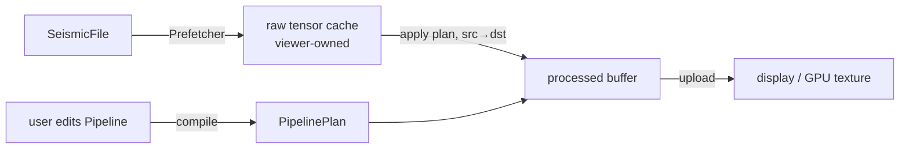

# Integrating parseSEG, processSEG and the viewer

Status: **draft**, written before the viewer exists. It fixes who owns what, the data that
crosses each boundary, and the changes parseSEG needs. Update it whenever an API it
describes changes.

## The three parts

| Part | Owns | Never does |
|---|---|---|
| **parseSEG** | Files: open, index, keys, headers, sample decode into tensors, prefetch, writers, journaled header edits | Signal processing; knows nothing of processSEG |
| **processSEG** | Numerics on traces: FFT and spectra, filters, gain, mutes, velocities and moveout, NMO, stacking, geometry QC, first breaks | UI; owning the viewer's open files or caches |
| **viewer** | Sessions, open files, caches of decoded data, threads that keep the UI responsive, drawing (CPU or GPU), user parameters | Decoding formats or doing DSP itself |

Dependencies point one way: `viewer → processSEG → parseSEG`, and `viewer → parseSEG`
directly. processSEG imports parseSEG for its tensor type (Arraymancer `Tensor[T]`, which
parseSEG re-exports) and, in its adapter modules only, for `SeismicFile`.

## Who reads the file?

**The viewer does.** It opens the `SeismicFile` with parseSEG, runs the `Prefetcher`, and
keeps the decoded *raw* tensors. It hands processSEG a tensor plus a small metadata record
(`ChunkMeta`), and processSEG processes it in place or into a second buffer.

The processSEG core never opens a file, so it is testable on synthetic arrays and usable
on data from anywhere. Two thin layers sit on top of it:

- **Metadata adapters** (`processSEG/adapters`): build `ChunkMeta` from a `SeismicFile`
  and a trace range or list. They gather sample interval, first-sample time, offsets and
  midpoints with parseSEG's column reads, so the viewer does not have to know which header
  holds what.
- **Batch drivers** (`processSEG/batch`): jobs that must read many traces in a particular
  order, such as a brute stack or a first-break pass over a whole file. They take a
  `SeismicFile`, read through parseSEG's prefetcher, report progress through a
  `Progress`-style hook that can cancel, and return in-memory results.

## Data contract

- **Samples:** `Tensor[float32]` (or `float64`) shaped `[traces, samples]`, row-major and
  C-contiguous, exactly what `readTraces`, `readTracesInto` and `PrefetchChunk.samples`
  return. The kernels underneath take `var openArray[T]` rows, so a caller can also pass
  any contiguous buffer.
- **One sample interval per call.** A chunk passed to a plan has a single `dt`. SEG-D
  records can mix intervals across channel sets, so the viewer (or the adapter) splits
  chunks by channel set. Auxiliary traces are excluded with parseSEG's `isSeismic`.
- **`ChunkMeta`:** `dtMs` (one value), and per trace `t0Ms` (time of sample 0), `offset`,
  `cmpX` and `cmpY`, the bin or CDP number, and a liveness flag (parseSEG's zero rows for
  undecodable traces are not live). Unknown values are NaN, as in parseSEG's `TraceKeys`.
- **Units:** time in ms, frequency in Hz, gain in dB, and velocity in distance units per
  second, with distance in the file's coordinate units (`summary.coordinateUnits`).
  processSEG never converts feet and metres silently.
- **Errors:** as in parseSEG. A bad argument (an empty band, a negative window) raises
  `ValueError` when the plan is built, not per chunk. Applying a valid plan does not raise.
  NaN or Inf in the input stays local to its trace and does not poison its neighbours.

## Plans and buffers: the interactive loop

A processing flow is a `Pipeline`: an ordered list of operations, held as plain data. The
viewer edits it when the user moves a slider. Compiling it for a `dt` and a trace length
gives a `PipelinePlan`, with filter responses, FFT plans and gain curves precomputed. A
plan is immutable after compilation, so any number of threads can share one. Each thread
brings its own `Workspace`: the scratch memory that keeps `apply` from allocating.

- **In place where possible.** `apply(plan, var x, meta, ws)` works in place. The viewer,
  though, must keep the raw data so that it can reprocess when a parameter changes, so it
  uses `apply(plan, src, var dst, meta, ws)`. That form costs one copy fused into the first
  operation, never a separate pass. A batch job with no raw cache works in place.
- **Recompiling is cheap** (microseconds to a few ms), so the viewer can recompile on every
  slider event. It applies the newest plan, and a chunk processed with a stale plan is
  simply processed again.
- **No hidden threads.** Kernels are single-threaded and reentrant, with no globals.
  Parallelism comes from the caller's threads, from the parseSEG prefetcher hook (P2
  below), or from processSEG's opt-in `parallelApply`, which takes a worker count.

## Sample windows and edge effects

Filters and AGC need context beyond the samples on screen. A zoomed view that decodes
only samples `a..b` would show edge artefacts at both ends of the window. `requiredMargin(plan)`
gives the extra samples to decode on each side. The viewer decodes `a - m .. b + m`,
processes it, and draws `a..b`. For full traces, processSEG handles the trace ends itself:
it removes the mean or trend, pads by reflection, and tapers, so the first samples of a
trace do not swing after a low-cut filter.

## Display gain: CPU or GPU

Viewers usually offer **fixed**, **normalized** and **AGC** display gain.

- **Fixed and normalized** gain are a scale factor per trace or per panel. processSEG
  computes the statistics (per-trace RMS, max and percentile clip values), and the viewer
  can apply the factor as a shader uniform, with no CPU pass over the samples.
- **AGC, time-variant dB curves and filters** change sample values in a way that depends
  on time, so they run on the CPU, in the plan.

Both paths give the same picture: the CPU gain ops exist too, for exports and tests.

## Overlays: moveout ticks for geometry checks

The viewer passes each trace's offset (from `ChunkMeta` or `traceKeys`) and the user's
velocity parameters. processSEG returns one time per trace for each curve:

- linear moveout, `t = t0 + |x| / v`, for first-break and refraction checks;
- hyperbolic moveout, `t = sqrt(t0² + x² / v²)`, for reflections;
- either kind from a velocity function or field instead of a constant velocity.

The viewer draws these ticks. If the ticks drift from the first breaks across a spread,
the geometry is suspect. processSEG's QC module can also score this fit automatically.

## Batch results: brute stack

`bruteStack(f, velocity, binning, opts, progress)` reads the file through parseSEG and
NMO-corrects each trace. It accumulates the corrected traces into CMP bins in any order,
because stacking is linear and needs no sort. It returns a `StackResult`: a
`[bins, samples]` tensor, the fold per bin, and the bin geometry. The viewer shows it as an
in-memory dataset. Writing it to a file needs parseSEG change P3.

## Proposed parseSEG changes

| # | Change | Why |
|---|---|---|
| P1 | A public `startTimeMs(f, trace)` (and a column form): the time of sample 0, across standards. SEG-Y: delay recording time × time scalar. SEG-D: the channel set start time. SEG-2: DELAY. | Every time-dependent operation, and every time axis, needs it. Today it is private (`segyTimeMs` in `convert/toseg2`). |
| P2 | An optional per-chunk `transform` callback on `newPrefetcher`, run on the worker thread right after decoding: `proc (samples: var Tensor[T], first, count: int) {.gcsafe, raises: [].}`. | Processing then runs on the prefetch workers while the chunk is still in cache, with no second thread pool or ring. It suits batch use. The viewer can keep its raw cache by prefetching raw data and processing on its own threads. |
| P3 | A writer path for derived traces: `writeTrace` with header overrides, such as a template trace's headers with `cdp`, `fold` and `offset` changed. | It lets a stack, or other derived traces that have no source trace, be written as SEG-Y. |
| P4 | A helper that splits a range or list into runs of one channel set and one sample interval. | Enforces "one `dt` per call" cheaply, so each viewer does not re-implement it. |

Until P1 and P4 land, processSEG's adapters do the same work with `traceFieldColumn`,
`traceEntry` and `channelSets`.

## Viewer checklist

1. Open with `openSeismic`, using an index cache and a `progress` hook. Use `keys = true`
   only if gathers or geometry are needed for the whole file.
2. Prefetch raw chunks, and keep them in a raw cache.
3. Build `ChunkMeta` with `processSEG/adapters`, or from the keys the viewer already has.
4. Edit a `Pipeline`, `compile` it, and give each processing thread its own `Workspace`.
5. `apply(plan, raw, processed, meta, ws)`, then draw. Apply fixed or normalized gain as a
   shader uniform from `traceStats`, if the GPU is used.
6. For zoom windows, decode with `requiredMargin(plan)`.
7. For overlays, call `moveoutTimes(offsets, model)` and draw the ticks.
8. For a brute stack, run `bruteStack` on a background thread with a cancel hook.

## Open questions

- Does the viewer want processSEG's `parallelApply`, or will it run its own job system?
  This decides whether the pool is public API or a test helper.
- Will 3D CMP binning come from the file (inline and crossline in a Layout stanza), from
  a user-defined grid, or both? Both are planned. The viewer decides the UI.
