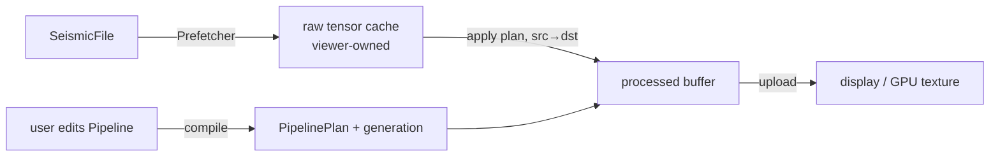

# Integrating parseSEG, processSEG and the viewer

Status: written before the viewer exists, revised for parseSEG 0.7.0 and 0.8.0 and for each phase's
API since. It fixes who owns what, the data that crosses each boundary, and what processSEG
needs from parseSEG. Update it whenever an API it describes changes. The names below are the
real API as of the 0.1.0 release candidate (Phase 9: the pipeline, the pool, moveout ticks,
velocity models, statics, NMO, the brute stack and the QC modules); `tests/utils/viewersim.nim`
acts out the viewer loop it describes, as a test. Task-oriented guides with tested examples
are in [guide/](guide/README.md), and every exported name is in [api.md](api.md).

## The three parts

| Part | Owns | Never does |
|---|---|---|
| **parseSEG** | Files: open, index, keys, headers, sample decode into tensors, prefetch, writers, journaled header edits, survey geometry joins (SPS, P1) | Signal processing; knows nothing of processSEG |
| **processSEG** | Numerics on traces: FFT and spectra, filters, gain, mutes, statics, velocities and moveout, NMO, stacking, geometry QC, first breaks | UI; owning the viewer's open files or caches |
| **viewer** | Sessions, open files, caches of decoded data, threads that keep the UI responsive, drawing (CPU or GPU), user parameters | Decoding formats or doing DSP itself |

Dependencies point one way: `viewer → processSEG → parseSEG`, and `viewer → parseSEG`
directly. processSEG imports parseSEG for its tensor type (Arraymancer `Tensor[T]`, which
parseSEG re-exports), for the per-trace data model (`TraceKeys` and the `TraceRows` view),
and, in its adapter and batch modules only, for `SeismicFile` and the prefetcher. The
`processSEG` umbrella does not re-export parseSEG: a viewer imports both
(`import parseSEG, processSEG`), and parseSEG never imports processSEG.
processSEG adds no C dependency: its FFT is pure Nim (mixed radix 2/3/4/5, batched across
traces).

## Who reads the file?

**The viewer does.** It opens the `SeismicFile` with parseSEG, runs the `Prefetcher`, and
keeps the decoded *raw* tensors. It hands processSEG a tensor plus a small metadata record
(`ChunkMeta`), and processSEG processes it in place or into a second buffer.

The processSEG core never opens a file, so it is testable on synthetic arrays and usable
on data from anywhere. Two thin layers sit on top of it:

- **Metadata adapters** (`processSEG/adapters`): `chunkMeta(c: PrefetchChunk)` and
  `chunkMeta(f, traces[, samples], failed = [])` for `readTracesInto` callers (`traces` a
  range or a list, `samples` the same sample window as the read). They copy nothing: a
  `ChunkMeta` wraps the chunk's `TraceRows` view, its interval (`intervalMs(rows)`, from
  the keys' `intervalUs`), its window origin (`c.firstSample` or `samples.a`) and its
  failed rows (`c.failedRows`, or the list filled by `readTracesInto(..., failedRows)`).
  Building one costs a single pass over the rows, to check that their intervals agree, and
  no allocation. Headers without
  an interval (SEG-Y leaves it 0 at times) raise `ValueError` asking for `dtMs`, which
  every `chunkMeta` takes as an override.

  **A raw cache keeps chunks after the prefetcher is closed or seeks.** That is safe:
  a chunk's `rows` view points into the file's index, so it stays valid while the file
  is open and its index unchanged (parseSEG documents it as "until the prefetcher's
  `close`" because the prefetcher keeps the index alive for a file closed under it).
  Moving a chunk, or a cache entry holding it, into a growing `seq` keeps its
  `failedRows` storage in place. A meta is cheap, so build it per apply
  (`chunkMeta(c)`) rather than storing it. After `applySurvey` or a header edit, rebuild
  the views (`c.rows = f.rowsOf(c.first ..< c.first + c.count)` for range-mode chunks;
  selection-mode chunks map `first` through the selection) and keep the raw samples.
- **Batch drivers** (`processSEG/batch`): jobs over a whole file, such as a brute stack or
  a first-break pass. They take a `SeismicFile` and run processing inside parseSEG's
  prefetcher, through its `transform` hook, with one `Workspace` per prefetch worker. They
  report progress through a `Progress`-style hook that can cancel, and return in-memory
  results.

## Data contract

**One data model, owned by parseSEG.** No header value is copied into a processSEG object.
Every per-trace value is read from parseSEG's `TraceRows` view when it is needed.

- **Samples:** `Tensor[float32]` (or `float64`) shaped `[traces, samples]`, row-major and
  C-contiguous, exactly what `readTraces`, `readTracesInto` and `PrefetchChunk.samples`
  return. Rows are zero-padded past a shorter trace's end. The kernels underneath take
  `var openArray[T]` rows, so a caller can also pass any contiguous buffer: `rowBlock`
  views a tensor (rank 2, C-contiguous, checked once) or a flat buffer as rows without
  copying, `b.row(r, n)` is the live head of a row, and `sub` splits a block for threads.
  Each kernel also has a block form on the tensor itself, in place (`samples.detrend(meta)`,
  `samples.muteTop(meta, lmoMute(1800, padMs = -20), taperMs = 30)`), that visits the live
  rows up to their live length.
- **One sample interval per call.** A chunk passed to a plan has a single `dt`. SEG-D
  records can mix intervals across channel sets, so the viewer prefetches with
  `uniform = true` (chunks never span two channel sets or intervals), or splits a range
  with `uniformRuns`. The adapter checks that the rows' `intervalUs` agree and raises
  `ValueError` on a mixed chunk.
- **`ChunkMeta`** is `{rows: TraceRows, dtMs, firstSample, failed}`, built and validated
  once by `initChunkMeta(rows, dtMs, firstSample = 0, failed = [])` (the adapters call it).
  Its fields are read through accessors (`rows`, `len`, `dtMs`, `firstSample`,
  `failedCount`, `failedRow(i)`), so a meta cannot be changed after it was checked, and
  `checkShape(meta, samples)` checks a tensor against it:
  - `rows`: the chunk's view (`PrefetchChunk.rows`, or `rowsOf(f, traces)`, or
    `rowsOf(keys, numSamples)` for synthetics). It must have keys (`hasKeys`), which is
    checked once, when the meta is built; kernels then read keys without raising;
  - `dtMs`: from the rows' `intervalUs`;
  - `firstSample`: the window origin, 0 unless the rows were decoded with a sample window
    (`readTracesInto(..., samples)` or the prefetcher's `firstSample`);
  - `failed`: the rows that could not be decoded (parseSEG leaves them zero), from
    `PrefetchChunk.failedRows` or a caller's list, ascending. It is held as a pointer and a
    length, so the meta can be copied to another thread, and the list must outlive the
    meta. `isFailed(row)` looks a row up in O(log n).
- **Per-row values** come straight from the view. Kernels read them with
  `meta.keys(row)`, which is parseSEG's non-raising `keysAt` (the meta checked `hasKeys`
  once). `isLive(row)`, `liveSamples(row, cols)`, `t0Ms(row)` and `sampleTimeMs(row, col)`
  apply the rules below, and none of them raises:
  - `.offset`: as in the file. SEG-Y header offsets may be signed; offsets parseSEG derives
    from coordinates (SEG-D Rev 3, SEG-2, survey joins) are the unsigned source-receiver
    distance. Formulas use |x|; split-spread QC takes the side from the coordinates
    (`rcvX − srcX` along the line), not from the offset's sign;
  - `.t0Ms`: the time of the trace's sample 0;
  - `.srcX`, `.srcY`, `.srcZ`, `.rcvX`, `.rcvY`, `.rcvZ`, `.cmpX`, `.cmpY`, `.ensemble`
    (CDP), `.inline`, `.crossline`;
  - `numSamples(row)`: the trace's real length. The live length within the window is that
    minus `firstSample`, clamped to the row width; filters, AGC and padding stop there.
- **Live traces:** a row is live when its `status` is `tsLive` or `tsUnknown` and it is not
  a failed row. Unset SEG-Y trace codes are common, so unknown counts as live. Dead and
  auxiliary traces are passed through untouched and are left out of stacks and panel
  statistics.
- **Time axis:** sample `j` of row `r` is at `t0Ms[r] + (firstSample + j) · dtMs`. A NaN
  `t0Ms` (an unknown SEG-D channel set) gives NaN times: processSEG never substitutes a
  default for an unknown key.
- **Units:** time in ms, frequency in Hz, gain in dB, and velocity in distance units per
  second, with distance in the file's coordinate units (`summary.coordinateUnits`).
  processSEG never converts feet and metres silently.
- **Errors:** as in parseSEG. A bad argument (an empty band, a negative window) raises
  `ValueError` when the plan is built, not per chunk; a bad `ChunkMeta` raises when it is
  built. Applying a valid plan does not raise. NaN or Inf in the input stays local to its
  trace and does not poison its neighbours.
- **Lifetimes** (parseSEG's rules, which `ChunkMeta` inherits):
  - `rowsOf(f, list)` keeps a pointer to the list: the list must outlive the view and the
    meta;
  - a view made before `ensureKeys` has no keys, so it cannot make a meta: make views after
    `ensureKeys`;
  - views, prefetchers and metas need their readers stopped before `applySurvey` or a
    `HeaderEditor` write, which rewrite the stored keys.

### Where the geometry comes from

All of it arrives through `TraceKeys`; processSEG never reads header bytes itself.

- **SEG-Y:** offsets and coordinates come from the trace headers. Inline and crossline are
  the keys' `inline` and `crossline`, taken from the layout's `iline` and `xline` fields
  (bytes 189 and 193 in Rev 1 and later, unless a Layout stanza or vendor map moves them).
- **SEG-D Rev 1/2:** the headers carry receiver and source line, point and index, but no
  coordinates, so the offset is NaN. The viewer joins SPS or P1 with `SurveyGeometry` and
  `applySurvey` on a file opened with `keys = true` (or after `ensureKeys`); the view then
  sees the joined keys. Without a join, moveout ticks, NMO and stacking have no offsets.
- **SEG-D Rev 3 and SEG-2:** coordinates when the file has them; offsets are derived from
  them, as distances (never negative).
- **Statics:** datum elevations, uphole times and the statics already applied are not in
  the keys. `traceStatics(f, traces)` reads them on demand, for elevation statics.
- **Changes:** `applySurvey` and `HeaderEditor` writes refresh the stored keys and bump
  `keysRevision(f)`. Anything derived from keys (moveout ticks, bins) records the revision
  it was made from and is recomputed when it changes.

## Plans and buffers: the interactive loop

A processing flow is a `Pipeline`: an ordered list of operations, held as plain data. The
viewer edits it when the user moves a slider. Compiling it for a `dt` and a trace length
gives a `PipelinePlan`, with filter responses, FFT plans and gain curves precomputed. A
plan is immutable after compilation and carries a `generation` id. Every thread that
applies a plan has its own `Workspace` (grow-only scratch that keeps `apply` from
allocating); a `ProcessPool` keeps one per worker, so pool users never see it.



```nim
var flow = initPipeline([demeanOp(),
                         bandPassOp(Corners(f1: 4, f2: 8, f3: 60, f4: 80)),
                         agcOp(windowMs = 500)])
let plan = flow.compile(float32, dtMs = 2, samples = 2001) # validates; ValueError
var ws = initWorkspace()
ws.reserve(plan)                          # grow-only; a no-op when it fits
plan.apply(raw, processed, meta, ws)      # src → dst, the raw cache kept
plan.apply(samples, meta, ws)             # in place
flow[2].agc.windowMs = 300                # a slider moved: edit the op, recompile
```

- **Ops** are plain data: an `Op` variant built by `demeanOp`, `detrendOp`, `scaleOp`,
  `gainDbOp`, `clipOp`, `polarityOp`, `muteTopOp`, `muteBottomOp`, `filterOp`
  (`bandPassOp` for the common case), `iirOp`, `agcOp`, `normalizeOp` and `gainCurveOp`.
  Their parameters are grouped per kind (`op.agc.windowMs`, `op.filter.spec`,
  `op.mute.taperMs`) and edited in place; asking an op for another kind's parameters
  raises `ValueError` (test `op.kind` when the user can reorder the flow). A `Pipeline`
  supports `add`, `insert`,
  `delete`, `[]`, `[]=`, `len` and `items`. Nothing is checked until `compile`, whose
  `ValueError` names the op (`op 1 (opFilter): ...`).
- **Order and cache.** `apply` runs every op on a tile of rows (about 256 KB) while it is
  in cache, then moves on. A per-panel normalization needs the whole panel, so it splits
  the plan into parts; its factor is applied at the start of the next part.
- **In place where possible.** `apply(plan, var x, meta, ws)` works in place. The viewer,
  though, must keep the raw data so that it can reprocess when a parameter changes, so it
  uses `apply(plan, src, var dst, meta, ws)`. That form costs one copy fused into the first
  operation (each tile is copied just before its first op), never a separate pass. `dst`
  is not resized: allocate it once per cached chunk. A batch job with no raw cache works in place.
- **Recompiling is cheap** (microseconds to a few ms), so the viewer can recompile on every
  slider event. A plan takes any block up to `plan.samples` wide, so a zoom window needs
  no recompile; one compiled for the window's width runs smaller FFTs. Compile that one
  with the record's length beside it, `flow.compile(float32, dtMs, samples = cols,
  recordSamples = traceLen)`: a gain curve is tabulated on the trace's time axis, and a
  table made for the first `cols` samples does not reach a window further down (off its
  table the curve is still right, but 4 times slower for a block of rows with one time
  axis and 65 times for single rows). Keep one plan per sample interval: a uniform
  prefetch of a mixed SEG-D file gives chunks at several intervals. `ws.reserve(plan)` is a no-op when the workspace is already big enough;
  `apply` never grows it (an `AssertionDefect` if it is too small).
- **Stale buffers.** Tag each processed buffer with the plan's `generation` **and** the
  file's `keysRevision`, and reprocess it when either differs: mutes read offsets, gain
  curves read `t0Ms`, and every op reads the trace status, so a join or a header edit
  changes the output of an unchanged plan. Generations are never 0 and increase across
  every plan the process compiles, so 0 can mean "never processed".
- **What allocates:** `compile`, `newProcessPool`, `reserve` when it grows, and the first
  `pool.apply` after a plan needing more scratch than any before (each worker grows its
  workspace). Every other `apply`, `pool.apply`, `chunkMeta(c)`, stats, spectrum and
  moveout call allocates nothing.
- **Threads.** processSEG offers three ways to run, from the simplest to the most control:
  1. **No threads.** `plan.apply(raw, processed, meta, ws)` on any thread. Kernels touch no
     globals, so several threads can each call `apply` with their own `Workspace`.
  2. **The pool.** `var pool = newProcessPool(workers = 4)` once, at viewer start-up, then
     `pool.apply(plan, raw, processed, meta)` per frame or chunk. The workers are started
     once and sleep between jobs, so a job costs a wake-up, not a thread start. A call
     splits the rows across the workers and returns when all are done. User code passes
     tensors and plans as usual: no pointers, no locks, no `Workspace` handling. One job
     runs at a time per pool, and a second caller waits. The pool cannot be copied, and
     destroying it stops and joins its workers. Each worker grows its own workspace on
     the first job that needs more, so the first frame after a plan that needs more
     scratch allocates once; later frames allocate nothing. Measured (bench/README "Process
     pool"): 6–12 µs per job, and a demean + band-pass + AGC flow over a 2000 × 2001
     panel takes 32 ms on one thread, 8.6 ms on 4 workers, 4.3 ms on 8.
  3. **Inside the prefetcher**, for batch jobs: the `transform` hook runs the plan on
     parseSEG's decode workers while the chunk is still in cache, with one `Workspace` per
     worker passed through the `user` pointer.

  No managed value crosses a thread: a tensor's storage is reference counted without
  atomics, and copying a seq (a plan holds some) allocates on the thread that copies it.
  The pool turns its arguments into raw pointers internally, and because `pool.apply`
  blocks until every worker is done, the data outlives the work. A viewer with its own job
  system uses the first form from each of its threads instead, on its own rows
  (`RowBlock.sub`, `ChunkMeta.sub`). A per-panel normalization needs the whole panel: such
  a viewer runs the plan part by part (`checkApply`, then per part `panelFactorOf` on
  one thread if `partNeedsPanel`, then `runPart` on every thread's rows), as the pool
  does.

## Sample windows and edge effects

Filters and AGC need context beyond the samples on screen. A zoomed view that decodes
only samples `a..b` would show edge artefacts at both ends of the window.

- `plan.requiredMargin` gives the extra samples to decode on each side: the sum of the
  filters' impulse-response lengths and the half AGC windows. `flow.requiredMargin(dtMs)`
  gives the same number from the `Pipeline` without compiling it.
- `decodeWindow(a .. b, m, traceLen)` is `max(0, a − m) .. min(traceLen − 1, b + m)`.
  The viewer decodes it (the prefetcher's `firstSample` and `cols`, or
  `readTracesInto`'s sample window; columns past a shorter trace's end come back zero
  and are outside its live length), builds the meta (`chunkMeta(c)` picks up
  `c.firstSample`), processes, and draws columns `a − w.a .. b − w.a`.

At the true ends of a trace, processSEG does the edge handling itself:

1. remove the mean or a linear trend;
2. pad by odd reflection, which keeps the value and the slope continuous, for as long as
   the filter's impulse response;
3. taper the pad only;
4. choose an FFT size at which the response does not wrap (`samples + 4L`: below −60 dB
   even for a spike on the last sample);
5. after filtering, add the trend back, scaled by the filter's gain at 0 Hz (a high-cut
   keeps a drift, a low-cut removes it).

So the first samples of a trace do not swing after a low-cut such as 1 Hz.

In a pipeline a filter is `filterOp(lowCut(0.5, 1))` (or `iirOp(butterLowCut(1))`), and
`plan.requiredMargin` sums the margins of all its ops. A filter also runs on its own:

```nim
let plan = initFilterPlan(float32, lowCut(0.5, 1), dtMs = 2, samples = 2001)
var ws = initWorkspace()
ws.reserve(plan.workspaceSize)
samples.applyFilter(meta, plan, ws)   # in place, live rows to their live length
let m = plan.requiredMargin           # L samples: decode a zoom window with m each side
```

Cost (bench/README "Filters", Ryzen 3950X): a band-pass of a 2000 × 2001 float32 panel
takes about 6 ms on 4 workers and 23 ms on one thread; the IIR form costs the same. Budget
one filter at ~6 ms per frame with the pool, and keep filtering off the draw thread
without it.

The impulse length `L` holds 99.9 % of the energy of the response or of its complement
(a narrow low-cut ramp is long: 0.5–1 Hz at 2 ms is 881 samples, 1.8 s), each edge and
notch measured on its own, so the narrowest one sets it. A window decoded with `m`
samples each side matches the whole trace filtered to within about 1 % of the traces'
peak on seismic data, not the window's own (see below), and 2.5 % in the worst case: a
steady in-band sinusoid, whose tail beyond `L` adds up coherently (measured 1.6–2.4 % for
4-8-60-80, 5-10-40-60 and 0.5–1 Hz low-cut band-passes at 2 ms; 1.5× the margin gives
under 0.5 %). Tested
for FFT and IIR filters, zero and minimum phase; a minimum-phase margin holds 99.99 % of
its causal impulse, since its whole error comes from the history before the window.

What the margin does and does not promise:

- the error is relative to the **strongest signal near the window**, not to the window's
  own peak. A quiet window next to a strong event just outside the margin (noise 46 dB
  below it, in parseSEG's `survey.sgy`) is within 1 % of the traces' peak but not of its
  own;
- a gain that equalizes (AGC, per-trace normalization) **after** a filter lifts that
  leak to the level of the quiet window: there, a zoomed AGC picture can differ by a few
  percent from the whole trace's (1.6 % of the window's peak in that file). More margin
  shrinks the filter's own leak fast (60× less at 1.5× the margin), but after AGC the
  error depends on where in the quiet zone the leak lands, and it is not monotonic in
  the margin (0.3 % at 1.5×, 8 % at 2×, 0.02 % at 3×, measured). Treat zooms of AGC data
  next to much stronger events as approximate;
- whole-trace ops (`demean`, `detrend`, per-trace normalization, the RMS that sets AGC's
  ε) use the statistics of the decoded window, so they cannot match the whole trace
  whatever the margin. Use the filters' trend removal instead of `demean` before a
  low-cut.

## Display gain: CPU or GPU

Viewers usually offer **fixed**, **normalized** and **AGC** display gain.

- **Fixed and normalized** gain are a scale factor per trace or per panel. processSEG
  computes the statistics (`processSEG/gain/stats`), and the viewer can apply the factor
  as a shader uniform, with no CPU pass over the samples:
  - `traceStatsInto(samples, meta, stats)`: RMS and max |x| per row (NaN for dead,
    auxiliary and failed rows), about 0.9 ms for a 2000 × 2001 panel;
  - `panelStats(samples, meta, ws, clipPercentile = 99, rows = a .. b)`: RMS, max and a
    percentile clip of |x| over the live rows (rows with a NaN or Inf are left out;
    `rows` counts the rows used), from a histogram with 0.4 % relative resolution (`ws` holds
    `panelStatsWorkspace`), about 4 ms for the same panel, so recompute it when the data
    or the selection changes, not per frame.
- **AGC, time-variant dB curves and filters** change sample values in a way that depends
  on time, so they run on the CPU, in the plan (`agcOp`, `normalizeOp`, `gainCurveOp`,
  `gainDbOp`). They also run on their own (`processSEG/gain/gain`):

  ```nim
  let agc = initAgcPlan(windowMs = 500, dtMs = 2, samples = 2001)  # agcRms or agcMeanAbs
  ws.reserve(agc.workspaceSize)
  samples.agc(meta, agc, ws)              # in place; or (..., gains) to keep the gain
  let m = agc.requiredMargin              # half the window, for zoom windows
  ```

  A time-variant gain (`knotGain([GainKnot(tMs: 0, dB: 0), GainKnot(tMs: 3000, dB: 18)])`,
  `powerGain(2)` or `exponentialGain(dbPerS)`) is tabulated once per `dt` and record
  length (`initGainCurvePlan(float32, curve, dtMs, samples)`), then
  `samples.applyGainCurve(meta, plan)` multiplies each live row by the table at its own
  times (`t0Ms`, `firstSample`): 0.5 ms per panel. Widen the table (`tMinMs`, `tMaxMs`) for
  rows that start before 0 or windows past the record; times outside it are exact but
  slower.

  AGC costs about 6.5 ms per 2000 × 2001 panel on one thread, whatever the window, so
  about 1.7 ms on 4 workers (the pool scales 3.75× on 4 workers for a whole flow). `normalize` (`initNormalizePlan(normRms | normMax |
  normPercentile, samples, perTrace | perPanel)`) and `scaleDb` are the CPU forms of the
  fixed and normalized display gains.

Both paths give the same picture: the CPU gain ops exist too, for exports and tests.

## Spectrum panel

`SpectrumPlan` (`processSEG/fft/spectrum`) gives the averaged amplitude spectrum of the
traces and time window a user selects. Make the plan once per window length and `dt`
(`initSpectrumPlan(float32, windowLen, dtMs, taperFraction = 0.1)`), reserve
`sp.workspaceSize`, then per selection:

```nim
let used = sp.averageAmplitudeInto(raw, meta, firstCol, amp, ws, rows = a .. b)
toDbInto(amp, db)                       # 0 dB at the peak (or dbAbsolute)
# x axis: sp.binHz(k), k in 0 ..< sp.bins
```

The window is demeaned, Tukey-tapered and zero-padded to the next power of two by default (a 60 s record at 1 ms, 60001 samples, gives nfft 65536, bins 0.015 Hz apart; pass `nfft` for another 2·3·5-smooth length); the average is over power across
the live rows (dead, auxiliary and failed rows and padding past a trace's end are left
out), and amplitudes are scaled so that a sinusoid of amplitude A on a bin reads A, also in a window shortened by a trace's end. The
window is given in columns of the block: the viewer converts its time selection with the
meta's time axis (`sampleTimeMs`). Rows with a NaN or Inf sample in the window are left out (the returned count says how many rows were used). It does not change the samples, so it runs on the raw
or the processed buffer. It allocates nothing once the workspace is reserved.

## Overlays: moveout ticks for geometry checks

The viewer passes the chunk's rows and the user's velocity parameters, and processSEG
fills one time per trace for each curve, reading each offset from the view
(`processSEG/velocity/moveout`):

```nim
let first = linearMoveout(velocity = 1800, t0Ms = 20)
var ticks = newSeq[float64](meta.len)               # once per chunk, reused
moveoutTimesInto(meta.rows, first, ticks)           # ms, one per row
moveoutColumnsInto(meta, hyperbolicMoveout(2200, t0Ms = 800), ticks)  # block columns
let tag = f.keysRevision                            # stale when it changes
```

The column form applies each row's `t0Ms` and the window's `firstSample`, so the value
is where to draw the tick over the block. Offsets keep their sign in the keys; the
formulas use |x|, so both sides of a split spread get the same times. A NaN offset (no
geometry yet) gives a NaN tick.

- linear moveout, `t = t0 + |x| / v`, for first-break and refraction checks
  (`linearMoveout`, `lmoTime`);
- hyperbolic moveout, `t = sqrt(t0² + x² / v²)`, for reflections (`hyperbolicMoveout`,
  `nmoTime`);
- hyperbolas from a velocity model (`processSEG/velocity/model`): `hyperbolicMoveout(f,
  t0Ms)` takes a `VelocityFunction`'s RMS velocity at `t0Ms`, and
  `moveoutTimesInto(meta, field, t0Ms, ticks)` / `moveoutColumnsInto(meta, field, t0Ms,
  ticks)` take a `VelocityField`'s at each row's location (the keys' `ensemble` in 2D,
  `inline`/`crossline` in 3D; a `locations` overload takes distances along the line).

Velocity picks load with `readVelocities(path)` (VELF cards, HANDVEL blocks or CSV,
detected) into `VelocityPick`s, and `initVelocityField(picks, dtMs, tMaxMs)` builds the
field once (it allocates nodes × grid samples × 8 bytes); queries allocate nothing.
Functions are interpolated in `V²·t`, so a knot at t = 0 sets only the value at 0 (see
the module doc). To flatten first breaks on the display, `applyLmo(samples, meta,
velocity, biasMs)` shifts each live row up by `|x|/v − biasMs` in place (`removeLmo`
undoes it, apart from what moved out of the row); it is a display transform on the
processed buffer, not a pipeline op.

The viewer draws these ticks
and tags them with `keysRevision(f)`: an `applySurvey` or header edit makes them stale. If
the ticks drift from the first breaks across a spread, the geometry is suspect.
processSEG's QC modules score this automatically (experimental for land data):

- `checkGeometryInto(meta, checks)` (`qc/geometry`): per-trace flags from the keys alone
  (header offset vs the source–receiver distance, zero, negative or missing offsets,
  missing coordinates, a midpoint off halfway); `flaggedRows(checks)` lists the bad ones.
- `initFirstBreakPlan(T, params, dtMs, samples)` and `plan.pickInto(samples, meta, ws,
  picks)` (`qc/firstbreak`): STA/LTA, modified energy ratio or modified Coppens, after an
  optional minimum-phase band-pass, in a fixed or LMO-guided window, with an SNR-based
  confidence per pick. The input samples are not changed: a plan with a band-pass filters
  `fftLanes` rows at a time into copies in the workspace (`plan.workspaceSize` holds
  them), one without picks from the rows in place. A plan is shareable, one `Workspace`
  per thread. Picks for the overlay are `picks[row].timeMs`. On a 2000-trace shot, picking
  takes 5–19 ms on one thread, 31–44 ms with the band-pass (bench/README).
- `fitShot([samples,] meta, picks, params, fit)` (`qc/shotfit`), per shot (a `meta.sub`
  of its rows): a two-segment (crossover) L1 fit or an offset-binned one on the confident
  picks; residuals minus the neighbours' median along the spread (a laterally varying
  refractor bends them smoothly, a misplaced receiver jumps); with samples, the odd ones
  out by cross-correlation with the neighbours; `fit.suspect[row]` and `asymmetryMs` (a
  misplaced source).

## Batch results: brute stack

`bruteStack(f, T, [traces,] binning, velocity, opts, progress)` (`processSEG/batch`) reads
the file through parseSEG's prefetcher (`uniform = true`). On each chunk, in the
prefetcher's `transform` hook on its decode worker, it runs datum statics (optional,
`opts.useStatics` and `opts.statics = datumStatics(datumZ, vReplacement)`), the pre-stack
flow (`opts.flow`, a `Pipeline`: mutes, filters, gain), NMO with a stretch mute
(`opts.nmo = initNmoParams(interp, maxStretch, taperMs)`) onto the stack's time axis, and
accumulates each live trace into its bin. Stacking is linear and needs no sort; the fold
is counted per sample, between each trace's first and last non-zero samples, so muted
zeros do not count.

- **Bins:** `cdpBinning` (header CDP), `lineBinning` (midpoints projected onto a line),
  `gridBinning` (a rotated 3D grid) or `inlineCrosslineBinning` (header numbers).
- **Velocities:** a `VelocityFunction` for every bin, or a `VelocityField` read at each
  bin's location: its CDP number in 2D, its inline and crossline in 3D
  (`binning.location(bin)`).
- **Threads:** `opts.workers` prefetch workers, each with its own `Workspace` and
  `StackAccumulator`, merged at the end; everything is allocated on the calling thread
  before the workers start.
- **Progress and cancel:** `progress(done, total)` (parseSEG's `Progress`) after every
  chunk, on the calling thread; returning false stops the workers and raises
  `SegCancelledError`. A viewer runs `bruteStack` on a background thread of its own.
- **Result:** a `StackResult`: `data` (`[bins, samples]`, normalized by fold, √fold or
  not), `fold` (`[bins, samples]`, int32), `binning`, `dtMs`, `startMs`, `stacked`,
  `skipped` (live traces outside every bin, with a NaN offset, t0 or static, no
  interval, non-finite samples, or fully stretch-muted) and `failed` (traces that could
  not be decoded). With several workers the sums are added in a varying order: runs agree
  to rounding, not bit for bit.
- **Memory:** `workers + 1` stacks of bins × samples × (sizeof(T) + 4) bytes, plus the
  prefetch ring and the flow's scratch (`bruteStackMemory`). A float32 3D stack of
  100 000 bins × 2001 samples is 1.6 GB per copy: use one or two workers for it.

The viewer shows the result as an in-memory dataset; processSEG describes results and
parseSEG writes them (D14): `stackKeys(res, bin)` and `stackOverrides(res, bin)` give each
bin's headers for parseSEG's `writeTrace`. As a convenience, `writeStack(path, res, opts)` saves
it as SEG-Y, whatever the input standard, one trace per bin (patch F3: headers built from
`TraceKeys`, no template trace): the bin's CDP number (3D: its 1-based index), inline and
crossline, centre as CDP X/Y, offset 0, `startMs` and `dtMs`, the largest per-sample fold
in `numHorzStacked`, and a dead trace for a bin with no fold. `opts` is parseSEG's
`SegyOutputOptions` (revision, byte order, sample format, textual header; trace sorting 4
by default). `openSeismic` reads the keys back.

## What processSEG needed from parseSEG (0.7.0, 0.8.0)

The changes this doc first proposed (P1–P4) all landed in parseSEG 0.7.0, which processSEG
requires:

| Was | Now in parseSEG 0.7.0 |
|---|---|
| P1: the time of sample 0 | `TraceKeys.t0Ms`, and `startTimeMs` / `startTimeMsInto` |
| P2: a per-chunk prefetch transform | `newPrefetcher(..., transform: ChunkTransform[T], user: pointer)`, run on the worker with its index; `PrefetchChunk.rows` and `.failedRows` |
| P3: writing derived traces | `writeTrace(..., overrides = [headerOverride(...)])` with a template trace of the output's standard |
| P4: runs of one channel set and interval | `uniform = true` on the prefetcher, and `uniformRuns(f, range \| list)` |
| (new) one data model | `TraceRows` views, `TraceKeys` with `inline`, `crossline`, `intervalUs`, `traceCode`, `status`; `ensureKeys` and `keysRevision`; keys kept current by `HeaderEditor` writes; `traceStatics` |

What processSEG needed beyond that landed in parseSEG **0.8.0** (pull request #1), which
processSEG now requires:

| # | Change | Why |
|---|---|---|
| F1 | `keysAt(rows, row)`, the non-raising form of `traceKeys` for callers that checked `hasKeys` once (no keys is an `AssertionDefect` with bound checks on) | `traceKeys(rows, row)` raises `ValueError`, so a `{.raises: [].}` kernel or a `ChunkTransform` cannot call it |
| F2 | `readTracesInto(f, traces[, samples], dst, failedRows, row = 0)` fills a caller's `var seq[int]` (cleared, capacity kept, no log), as `PrefetchChunk.failedRows` | The other forms report failed traces only through a `DiagLog`, which allocates per failure |
| F4 | `PrefetchChunk.firstSample`, the prefetcher's window origin | `chunkMeta(c)` needs it, and a chunk did not record it |
| F3 | `openSeismicWriter(path, SegyOutputOptions(...))`, a SEG-Y file with no input to model, and `writeTrace(w, keys, samples, overrides)`, a trace whose headers come from `TraceKeys` (standard layout; `openSeismic` reads the same keys back) | A stack of SEG-D or SEG-2 input could not be written as SEG-Y: `writeTrace` needed a template trace of the output's standard |

Checked again for the pipeline, the pool and the viewer loop (task 5.4): nothing else is
missing. The `transform` hook is not given the prefetcher's `firstSample`;
`bruteStack` decodes whole traces (`firstSample = 0`), and a windowed batch driver would
pass it through `user`, with the workspaces.

## Viewer checklist

1. Open with `openSeismic`, using an index cache and a `progress` hook, with `keys = true`
   (or call `ensureKeys` before making any view). Join SPS or P1 geometry with
   `applySurvey` if needed (SEG-D Rev 1/2), before any reader starts.
2. Prefetch raw chunks with `uniform = true`, and keep them in a raw cache.
3. Make a `ChunkMeta` per chunk with `chunkMeta(c)`: it wraps `c.rows`, the interval,
   `c.firstSample` and `c.failedRows`, and copies nothing. For a direct read, pass a reused
   `var seq[int]` to `readTracesInto` and build the meta with the same arguments,
   `chunkMeta(f, traces[, samples], failed)`.
4. Edit a `Pipeline` and `compile` it, once per sample interval and row width in the
   cache.
5. Create one `ProcessPool` at start-up (`newProcessPool(workers)`), then
   `pool.apply(plan, raw, processed, meta)` into a processed buffer allocated once per
   cached chunk, tag the result with `plan.generation`, and draw. (Or call `plan.apply` from your own threads,
   each with its own `Workspace` and `reserve(plan)`.) Apply fixed or normalized gain as a
   shader uniform from `traceStatsInto` or `panelStats` (or `panelFactor`), if the GPU
   is used.
6. For zoom windows, decode `decodeWindow(shown, flow.requiredMargin(dtMs), traceLen)`
   (the prefetcher's `firstSample` and `cols`; `chunkMeta(c)` picks up `c.firstSample`),
   process, and draw the shown columns. See "Sample windows" for what the margin promises.
7. For overlays, fill moveout columns with `moveoutColumnsInto(meta, curve, ticks)`, tag
   them with `f.keysRevision`, and draw the ticks (`moveoutTimesInto(meta, ...)` gives ms).
8. Before `applySurvey` or a header edit, stop the prefetcher and any processing; after
   it, rebuild views and metas, and recompute anything tagged with an older revision:
   ticks, bins and processed buffers (the raw samples stay valid).
9. For a brute stack, run `bruteStack` on a background thread, with a `progress` hook
   that returns false to cancel.

## Open questions

- Will 3D CMP binning come from the file (the keys' `inline` and `crossline`), from a
  user-defined grid, or both? Both exist (`inlineCrosslineBinning`, `gridBinning`). The
  viewer decides the UI.
- Does the viewer want an asynchronous `submit` / `wait` pair on the pool, so a frame can
  be abandoned before it finishes? It is added only if the viewer asks for it.
- Is the zoom margin's worst case good enough on screen? A window decoded with
  `requiredMargin` is within about 1 % of the whole trace's filtered result on seismic
  data, but up to 2.5 % for a steady in-band sinusoid ("Sample windows"); 1.5× the
  margin gives under 0.5 %, at 50 % more decoded samples per zoom edge. A viewer that
  sees the difference can decode `ceil(1.5 · requiredMargin)` without any library
  change; if it always does, the library's margin should grow instead.

Settled: the pool is public API (`ProcessPool`, decided 2026-11-09).
