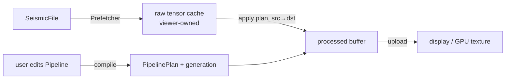

# Integrating parseSEG, processSEG and the viewer

Status: **draft**, written before the viewer exists and revised for parseSEG 0.7.0. It
fixes who owns what, the data that crosses each boundary, and what processSEG needs from
parseSEG. Update it whenever an API it describes changes. Names marked *(sketch)* settle
in task 5.1.

## The three parts

| Part | Owns | Never does |
|---|---|---|
| **parseSEG** | Files: open, index, keys, headers, sample decode into tensors, prefetch, writers, journaled header edits, survey geometry joins (SPS, P1) | Signal processing; knows nothing of processSEG |
| **processSEG** | Numerics on traces: FFT and spectra, filters, gain, mutes, statics, velocities and moveout, NMO, stacking, geometry QC, first breaks | UI; owning the viewer's open files or caches |
| **viewer** | Sessions, open files, caches of decoded data, threads that keep the UI responsive, drawing (CPU or GPU), user parameters | Decoding formats or doing DSP itself |

Dependencies point one way: `viewer → processSEG → parseSEG`, and `viewer → parseSEG`
directly. processSEG imports parseSEG for its tensor type (Arraymancer `Tensor[T]`, which
parseSEG re-exports), for the per-trace data model (`TraceKeys` and the `TraceRows` view),
and, in its adapter and batch modules only, for `SeismicFile` and the prefetcher.
processSEG adds no C dependency: its FFT is pure Nim (mixed radix 2/3/4/5, batched across
traces).

## Who reads the file?

**The viewer does.** It opens the `SeismicFile` with parseSEG, runs the `Prefetcher`, and
keeps the decoded *raw* tensors. It hands processSEG a tensor plus a small metadata record
(`ChunkMeta`), and processSEG processes it in place or into a second buffer.

The processSEG core never opens a file, so it is testable on synthetic arrays and usable
on data from anywhere. Two thin layers sit on top of it:

- **Metadata adapters** (`processSEG/adapters`): `chunkMeta(c: PrefetchChunk)` and
  `chunkMeta(f, traces, firstSample = 0, failed = [])` for `readTracesInto` callers
  (`traces` a range or a list). They copy nothing: a `ChunkMeta` wraps the chunk's
  `TraceRows` view, its interval (`intervalMs(rows)`, from the keys' `intervalUs`), its
  window origin (`c.firstSample`) and its failed rows (`c.failedRows`, or the list filled
  by `readTracesInto(..., failedRows)`). Building one costs a single pass over the rows, to
  check that their intervals agree, and no allocation. A chunk's meta is valid until the
  chunk is filled again.
- **Batch drivers** (`processSEG/batch`): jobs over a whole file, such as a brute stack or
  a first-break pass. They take a `SeismicFile` and run processing inside parseSEG's
  prefetcher, through its `transform` hook, with one `Workspace` per prefetch worker. They
  report progress through a `Progress`-style hook that can cancel, and return in-memory
  results.

## Data contract

**One data model, owned by parseSEG.** No header value is copied into a processSEG object.
Every per-trace value is read from parseSEG's `TraceRows` view when it is needed.

- **Samples:** `Tensor[float32]` (or `float64`) shaped `[traces, samples]`, row-major and
  C-contiguous, exactly what `readTraces`, `readTracesInto` and `PrefetchChunk.samples`
  return. Rows are zero-padded past a shorter trace's end. The kernels underneath take
  `var openArray[T]` rows, so a caller can also pass any contiguous buffer: `rowBlock`
  views a tensor (rank 2, C-contiguous, checked once) or a flat buffer as rows without
  copying, `b.row(r, n)` is the live head of a row, and `sub` splits a block for threads.
  Each kernel also has a block form on the tensor itself, in place (`samples.detrend(meta)`,
  `samples.muteTop(meta, lmoMute(1800, padMs = -20), taperMs = 30)`), that visits the live
  rows up to their live length.
- **One sample interval per call.** A chunk passed to a plan has a single `dt`. SEG-D
  records can mix intervals across channel sets, so the viewer prefetches with
  `uniform = true` (chunks never span two channel sets or intervals), or splits a range
  with `uniformRuns`. The adapter checks that the rows' `intervalUs` agree and raises
  `ValueError` on a mixed chunk.
- **`ChunkMeta`** is `{rows: TraceRows, dtMs, firstSample, failed}`, built and validated
  once by `initChunkMeta(rows, dtMs, firstSample = 0, failed = [])` (the adapters call it).
  Its fields are read through accessors (`rows`, `len`, `dtMs`, `firstSample`,
  `failedCount`, `failedRow(i)`), so a meta cannot be changed after it was checked, and
  `checkShape(meta, samples)` checks a tensor against it:
  - `rows`: the chunk's view (`PrefetchChunk.rows`, or `rowsOf(f, traces)`, or
    `rowsOf(keys, numSamples)` for synthetics). It must have keys (`hasKeys`), which is
    checked once, when the meta is built; kernels then read keys without raising;
  - `dtMs`: from the rows' `intervalUs`;
  - `firstSample`: the window origin, 0 unless the rows were decoded with a sample window
    (`readTracesInto(..., samples)` or the prefetcher's `firstSample`);
  - `failed`: the rows that could not be decoded (parseSEG leaves them zero), from
    `PrefetchChunk.failedRows` or a caller's list, ascending. It is held as a pointer and a
    length, so the meta can be copied to another thread, and the list must outlive the
    meta. `isFailed(row)` looks a row up in O(log n).
- **Per-row values** come straight from the view. Kernels read them with
  `meta.keys(row)`, which is parseSEG's non-raising `keysAt` (the meta checked `hasKeys`
  once). `isLive(row)`, `liveSamples(row, cols)`, `t0Ms(row)` and `sampleTimeMs(row, col)`
  apply the rules below, and none of them raises:
  - `.offset`: as in the file. SEG-Y header offsets may be signed; offsets parseSEG derives
    from coordinates (SEG-D Rev 3, SEG-2, survey joins) are the unsigned source-receiver
    distance. Formulas use |x|; split-spread QC takes the side from the coordinates
    (`rcvX − srcX` along the line), not from the offset's sign;
  - `.t0Ms`: the time of the trace's sample 0;
  - `.srcX`, `.srcY`, `.srcZ`, `.rcvX`, `.rcvY`, `.rcvZ`, `.cmpX`, `.cmpY`, `.ensemble`
    (CDP), `.inline`, `.crossline`;
  - `numSamples(row)`: the trace's real length. The live length within the window is that
    minus `firstSample`, clamped to the row width; filters, AGC and padding stop there.
- **Live traces:** a row is live when its `status` is `tsLive` or `tsUnknown` and it is not
  a failed row. Unset SEG-Y trace codes are common, so unknown counts as live. Dead and
  auxiliary traces are passed through untouched and are left out of stacks and panel
  statistics.
- **Time axis:** sample `j` of row `r` is at `t0Ms[r] + (firstSample + j) · dtMs`. A NaN
  `t0Ms` (an unknown SEG-D channel set) gives NaN times: processSEG never substitutes a
  default for an unknown key.
- **Units:** time in ms, frequency in Hz, gain in dB, and velocity in distance units per
  second, with distance in the file's coordinate units (`summary.coordinateUnits`).
  processSEG never converts feet and metres silently.
- **Errors:** as in parseSEG. A bad argument (an empty band, a negative window) raises
  `ValueError` when the plan is built, not per chunk; a bad `ChunkMeta` raises when it is
  built. Applying a valid plan does not raise. NaN or Inf in the input stays local to its
  trace and does not poison its neighbours.
- **Lifetimes** (parseSEG's rules, which `ChunkMeta` inherits):
  - `rowsOf(f, list)` keeps a pointer to the list: the list must outlive the view and the
    meta;
  - a view made before `ensureKeys` has no keys, so it cannot make a meta: make views after
    `ensureKeys`;
  - views, prefetchers and metas need their readers stopped before `applySurvey` or a
    `HeaderEditor` write, which rewrite the stored keys.

### Where the geometry comes from

All of it arrives through `TraceKeys`; processSEG never reads header bytes itself.

- **SEG-Y:** offsets and coordinates come from the trace headers. Inline and crossline are
  the keys' `inline` and `crossline`, taken from the layout's `iline` and `xline` fields
  (bytes 189 and 193 in Rev 1 and later, unless a Layout stanza or vendor map moves them).
- **SEG-D Rev 1/2:** the headers carry receiver and source line, point and index, but no
  coordinates, so the offset is NaN. The viewer joins SPS or P1 with `SurveyGeometry` and
  `applySurvey` on a file opened with `keys = true` (or after `ensureKeys`); the view then
  sees the joined keys. Without a join, moveout ticks, NMO and stacking have no offsets.
- **SEG-D Rev 3 and SEG-2:** coordinates when the file has them; offsets are derived from
  them, as distances (never negative).
- **Statics:** datum elevations, uphole times and the statics already applied are not in
  the keys. `traceStatics(f, traces)` reads them on demand, for elevation statics.
- **Changes:** `applySurvey` and `HeaderEditor` writes refresh the stored keys and bump
  `keysRevision(f)`. Anything derived from keys (moveout ticks, bins) records the revision
  it was made from and is recomputed when it changes.

## Plans and buffers: the interactive loop

A processing flow is a `Pipeline`: an ordered list of operations, held as plain data. The
viewer edits it when the user moves a slider. Compiling it for a `dt` and a trace length
gives a `PipelinePlan`, with filter responses, FFT plans and gain curves precomputed. A
plan is immutable after compilation and carries a `generation` id. Every thread that
applies a plan has its own `Workspace` (grow-only scratch that keeps `apply` from
allocating); a `ProcessPool` keeps one per worker, so pool users never see it.

- **In place where possible.** `apply(plan, var x, meta, ws)` works in place. The viewer,
  though, must keep the raw data so that it can reprocess when a parameter changes, so it
  uses `apply(plan, src, var dst, meta, ws)`. That form costs one copy fused into the first
  operation, never a separate pass. A batch job with no raw cache works in place.
- **Recompiling is cheap** (microseconds to a few ms), so the viewer can recompile on every
  slider event, or on a zoom that changes the trace length. `ws.reserve(plan)` is a no-op
  when the workspace is already big enough. The viewer tags each processed buffer with the
  plan's generation and reprocesses any buffer whose generation is stale.
- **Threads.** processSEG offers three ways to run, from the simplest to the most control:
  1. **No threads.** `plan.apply(raw, processed, meta, ws)` on any thread. Kernels touch no
     globals, so several threads can each call `apply` with their own `Workspace`.
  2. **The pool.** `var pool = newProcessPool(workers = 4)` once, at viewer start-up, then
     `pool.apply(plan, raw, processed, meta)` per frame or chunk. The workers are started
     once and sleep between jobs, so a job costs a wake-up, not a thread start. A call
     splits the rows across the workers and returns when all are done. User code passes
     tensors and plans as usual: no pointers, no locks, no `Workspace` handling. One job
     runs at a time per pool, and a second caller waits. The pool cannot be copied, and
     destroying it stops and joins its workers.
  3. **Inside the prefetcher**, for batch jobs: the `transform` hook runs the plan on
     parseSEG's decode workers while the chunk is still in cache, with one `Workspace` per
     worker passed through the `user` pointer.

  Arraymancer tensors and Nim seqs are ref-counted, and the count is not atomic, so no
  tensor, seq or plan value crosses a thread. The pool turns its arguments into raw
  pointers internally, and because `pool.apply` blocks until every worker is done, the
  data outlives the work. A viewer with its own job system uses the first form from each
  of its threads instead.

## Sample windows and edge effects

Filters and AGC need context beyond the samples on screen. A zoomed view that decodes
only samples `a..b` would show edge artefacts at both ends of the window.

- `requiredMargin(plan)` gives the extra samples to decode on each side. It comes from
  the impulse-response length of the filters and from half the AGC window.
- The viewer decodes `max(0, a − m) .. b + m` and sets `firstSample` in the `ChunkMeta`
  to match. After processing, it draws `a..b`.

At the true ends of a trace, processSEG does the edge handling itself:

1. remove the mean or a linear trend;
2. pad by odd reflection, which keeps the value and the slope continuous, for as long as
   the filter's impulse response;
3. taper the pad only;
4. choose an FFT size at which the response does not wrap.

So the first samples of a trace do not swing after a low-cut such as 1 Hz.

## Display gain: CPU or GPU

Viewers usually offer **fixed**, **normalized** and **AGC** display gain.

- **Fixed and normalized** gain are a scale factor per trace or per panel. processSEG
  computes the statistics (`traceStats`: per-trace RMS and max, and percentile clip values
  for a panel), and the viewer can apply the factor as a shader uniform, with no CPU pass
  over the samples.
- **AGC, time-variant dB curves and filters** change sample values in a way that depends
  on time, so they run on the CPU, in the plan.

Both paths give the same picture: the CPU gain ops exist too, for exports and tests.

## Overlays: moveout ticks for geometry checks

The viewer passes the chunk's rows and the user's velocity parameters, and processSEG
fills one time per trace for each curve, reading each offset from the view
(`moveoutTimesInto(meta.rows, lmo(velocity = 1800, t0Ms = 0), ticks)` *(sketch)*):

- linear moveout, `t = t0 + |x| / v`, for first-break and refraction checks;
- hyperbolic moveout, `t = sqrt(t0² + x² / v²)`, for reflections;
- either kind from a velocity function or field instead of a constant velocity (later).

The constant-velocity form ships early, with the pipeline. The viewer draws these ticks
and tags them with `keysRevision(f)`: an `applySurvey` or header edit makes them stale. If
the ticks drift from the first breaks across a spread, the geometry is suspect.
processSEG's QC module can also score this fit automatically, with an offset-binned or
two-segment fit, because land refractor velocities vary.

## Batch results: brute stack

`bruteStack(f, velocity, binning, flow, opts, progress)` reads the file through parseSEG.
On each trace it runs the pre-stack flow (offset-variant mute, elevation statics, filter,
gain) and NMO with a stretch mute. It accumulates the result into CMP bins in any order,
because stacking is linear and needs no sort, keeping a live count per sample.

It runs inside the prefetcher's `transform` hook with `uniform = true`, one `Workspace`
and one stack accumulator per worker, merged at the end.

It returns a `StackResult`: a `[bins, samples]` tensor, the fold, and the bin geometry.
It uses about bins × samples × 8 bytes, as float32 for the sum plus the live count. The
viewer shows the result as an in-memory dataset. A stack of SEG-Y input can be written
with `writeTrace(..., overrides = [headerOverride("trace.cdp", n), ...])` on a template
trace; a stack of SEG-D or SEG-2 input needs patch F3 (below).

## parseSEG 0.7.0 and the patch branch

The changes this doc first proposed (P1–P4) all landed in parseSEG 0.7.0, which processSEG
requires:

| Was | Now in parseSEG 0.7.0 |
|---|---|
| P1: the time of sample 0 | `TraceKeys.t0Ms`, and `startTimeMs` / `startTimeMsInto` |
| P2: a per-chunk prefetch transform | `newPrefetcher(..., transform: ChunkTransform[T], user: pointer)`, run on the worker with its index; `PrefetchChunk.rows` and `.failedRows` |
| P3: writing derived traces | `writeTrace(..., overrides = [headerOverride(...)])` with a template trace of the output's standard |
| P4: runs of one channel set and interval | `uniform = true` on the prefetcher, and `uniformRuns(f, range \| list)` |
| (new) one data model | `TraceRows` views, `TraceKeys` with `inline`, `crossline`, `intervalUs`, `traceCode`, `status`; `ensureKeys` and `keysRevision`; keys kept current by `HeaderEditor` writes; `traceStatics` |

What processSEG still needs, patched on parseSEG's `processseg-integration` branch and
offered upstream as one pull request:

| # | Change | Why |
|---|---|---|
| F1 | **Done on the branch:** `keysAt(rows, row)`, the non-raising form of `traceKeys` for callers that checked `hasKeys` once (no keys is an `AssertionDefect` with bound checks on) | `traceKeys(rows, row)` raises `ValueError`, so a `{.raises: [].}` kernel or a `ChunkTransform` cannot call it |
| F2 | **Done on the branch:** `readTracesInto(f, traces[, samples], dst, failedRows, row = 0)` fills a caller's `var seq[int]` (cleared, capacity kept, no log), as `PrefetchChunk.failedRows` | The other forms report failed traces only through a `DiagLog`, which allocates per failure |
| F4 | **Done on the branch:** `PrefetchChunk.firstSample`, the prefetcher's window origin | `chunkMeta(c)` needs it, and a chunk did not record it |
| F3 | (Optional) a SEG-Y trace written from `TraceKeys` plus overrides, with no template trace | A stack of SEG-D or SEG-2 input cannot be written as SEG-Y otherwise |

## Viewer checklist

1. Open with `openSeismic`, using an index cache and a `progress` hook, with `keys = true`
   (or call `ensureKeys` before making any view). Join SPS or P1 geometry with
   `applySurvey` if needed (SEG-D Rev 1/2), before any reader starts.
2. Prefetch raw chunks with `uniform = true`, and keep them in a raw cache.
3. Make a `ChunkMeta` per chunk with `chunkMeta(c)`: it wraps `c.rows`, the interval,
   `c.firstSample` and `c.failedRows`, and copies nothing. For a direct read, pass a reused
   `var seq[int]` to `readTracesInto` and build the meta with `chunkMeta(f, traces,
   firstSample, failed)`.
4. Edit a `Pipeline` and `compile` it.
5. Create one `ProcessPool` at start-up, then `pool.apply(plan, raw, processed, meta)`, tag
   the result with `plan.generation`, and draw. (Or call `plan.apply` from your own threads,
   each with its own `Workspace` and `reserve(plan)`.) Apply fixed or normalized gain as a
   shader uniform from `traceStats`, if the GPU is used.
6. For zoom windows, decode with `requiredMargin(plan)`, and set `firstSample`.
7. For overlays, fill moveout times from `meta.rows`, tag them with `keysRevision(f)`, and
   draw the ticks.
8. Before `applySurvey` or a header edit, stop the prefetcher and any processing; after
   it, rebuild views and metas, and recompute anything tagged with an older revision.
9. For a brute stack, run `bruteStack` on a background thread with a cancel hook.

## Open questions

- Will 3D CMP binning come from the file (the keys' `inline` and `crossline`), from a
  user-defined grid, or both? Both are planned. The viewer decides the UI.
- Does the viewer want an asynchronous `submit` / `wait` pair on the pool, so a frame can
  be abandoned before it finishes? It is added only if the viewer asks for it.

Settled: the pool is public API (`ProcessPool`, decided 2026-11-09).
